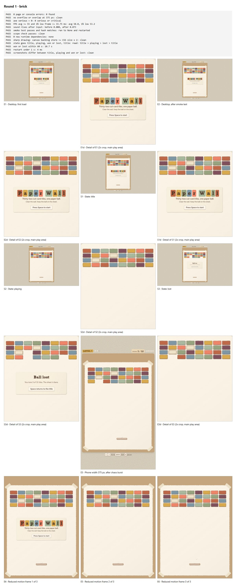

# Pareto AAA

A Hermes Agent plugin. You type one line, and Hermes builds a small web game, then keeps improving it until it scores 8 out of 10 or honestly tells you why it stopped.

```
/aaa make me a brick-breaker
```

<!-- DEMO -->

## Result on a real model

One run, 11 November 2026. Prompt: `/aaa make me a brick-breaker`. Model: DeepSeek V4.1 Flash for every job (worker, judge and second opinion), reasoning effort xhigh, on Hermes 0.23.1 on Windows.

| Round | Checks passed | Score | Time |
|---|---|---|---|
| 0 (build) | 12 of 13 (failed: page errors) | not judged | 23 min |
| 1 (fix) | 13 of 13 | judge 8/10, second opinion 8/10 | 19 min |

- Round 1 measurements: average 58.0 FPS, slowest 1% of frames at 53 FPS; sound responds to input; lost within 10.7 s; restart in 4 ms.
- Final line: `STATUS: AAA · score 8/10`. Total time: 48 minutes.
- About 10.0 M input tokens, 97% of them cache reads: about US$0.35 at that model's list prices.

Honest notes:

- The judge and the second opinion were the same model, so the 8 was not independently confirmed.
- A stronger model rating the same game from the same screenshots called it a strong 7: the ball and paddle were too small and faint. A readability rule was added to the style and to the judge after that run.
- No comparison run with the plugin off was made.
- This is one run only.
- A snake run on the general mode: <!-- SNAKE: TBD -->



The proof sheet the plugin wrote for round 1 (`aaa-proof.png`, reduced here).

## How a run works

Each round has three parts:

1. **Build.** A fresh worker gets a brief and builds or fixes the game. It starts with no memory of earlier rounds, only the brief and the judge's fix list.
2. **Check.** A real browser plays the game and measures it. The game must pass all 13 checks before anyone scores its looks:
   - it loads with no page or console errors and no new runtime dependencies;
   - the play-test script passes and is unchanged, and the worker changed only the files it may change;
   - 55+ average FPS, and the slowest 1% of frames take at most 33.75 ms;
   - sound responds to input;
   - the game goes title, playing, won or lost, title; a win or a loss happens within 60 seconds, and restart takes under 1 second;
   - the title, playing and won or lost screens look different;
   - canvas drawing is sharp (the canvas is sized for the screen's pixel density);
   - nothing runs off screen or overlaps at phone width (375 px);
   - no serious accessibility problems (axe-core).
3. **Judge.** A vision model compares screenshots with three reference pictures for the style (dated, clean, current) and gives a score from 0 to 10 with a short fix list.

The run stops at 8/10 (confirmed by a second opinion), when scores stop improving for two judged rounds, or at the round cap. Every run ends with one status line that the plugin writes itself, for example `STATUS: AAA · score 8/10` or `STATUS: PLATEAU · score 7/10`, followed by a plain "Why … Next …" line when it ends below 8.

**The worker can't fake the result.** Engine files and the plugin's own files are hash-checked, the worker's tools are limited during a round, and any status line a model writes is removed and replaced by the plugin's.

## Install

```
hermes plugins install babelaz-pareto-aaa
```

Until the catalog entry is merged, install from the repository instead:

```
hermes plugins install https://github.com/babelaz/babelaz-pareto-aaa
```

- Enabling asks to install one Python dependency, **Playwright**. Answer yes.
- If a Hermes gateway was already running, stop it once (`hermes gateway stop`) so it picks up the new dependency.
- No browser download is needed: the check uses your installed Chrome or Edge.
- `git` must be installed.
- Needs Hermes 0.22.7 or newer. Tested with a real model on Hermes 0.23.1 on Windows. On Linux only the mechanics were tested, with a stand-in model; macOS is untested.

## Use

1. Start Hermes in a folder that is **not** inside a git repository. Each run gets its own new folder there (inside a git repository, runs go to `~/aaa-runs` instead).
2. Type `/aaa <what to build>`.
3. The first time, it asks which models to use. `/aaa models 1` is the recommended answer; `/aaa models 2` runs everything on your own model.
4. It prints a line starting with `/goal`. Paste it and press Enter, then leave it to run.

Optional: `/aaa <prompt> --refs <folder>` passes 1 to 3 PNG pictures (at most 8 MB each) of a look you like.

Styles: two tuned styles, **brick** (a brick-breaker; tested: 8/10 on a real model, see above) and **catch**. Any other small game uses the house **paper** style and the general quality bar (experimental); its judge uses the brick reference pictures as quality levels only. A vague prompt ("make me a game") or an app or site prompt gets a reply with examples and starts nothing. One model is enough for every job; a model from a second family for the second opinion is recommended, so the check at 8 is independent. Engines: plain canvas by default. A worker may fetch three.js 0.187.0 or PixiJS 8.22.0 from npm once, at the first round; the check accepts only those exact, unmodified files (by hash).

Choosing other models: the plugin has three model slots, `aaa_judge` (the judge), `aaa_confirm` (the second opinion) and `aaa_smoke` (writes the play-test script, and the art direction for `--refs`). To use a different judge, for example:

```
hermes config set auxiliary.aaa_judge.provider <provider>
hermes config set auxiliary.aaa_judge.model <model>
hermes config set auxiliary.aaa_confirm.provider <provider>
hermes config set auxiliary.aaa_confirm.model <model>
hermes config set auxiliary.aaa_smoke.provider <provider>
hermes config set auxiliary.aaa_smoke.model <model>
```

Each command prints a warning that the key "is not a recognized config key". It is saved anyway, and the warning is harmless: the plugin registers these slots and reads them itself.

Reasoning effort: high or xhigh both work. Each slot call is allowed 15 minutes (a `timeout` you set for the slot wins).

## Cost and limits

- A run makes at most **7 worker runs and 14 judge calls** (a judge call that fails is retried once), billed by your own provider.
- About 5 M input tokens per round, almost all of them cache reads on providers that cache. Providers without caching will cost much more.
- A round takes 20-30 minutes on a mid-speed model, longer on rate-limited models. The plugin waits out rate limits and retries.
- Weaker models often stop at 6 or 7. The plugin says so and why; it never rounds up.
- Games only for now; apps are not supported.

## What leaves your machine

Calls to the model provider you already use in Hermes:

- the worker's build conversation;
- screenshots of the game plus the bundled reference pictures, sent to the judge and the second opinion;
- the game's code, sent to the model that writes the play-test script;
- your `--refs` pictures, sent once to that same model to write an art direction, and with the screenshots to the judge and the second opinion every round. They are never written to disk.

The only other network use: a worker may download one pinned engine file from npm at the first round (see Use).

The plugin never reads, copies or stores your API keys. It reads your model settings through `hermes config get`, and changes a setting only when you answer its question, except one: if `goals.max_turns` is below 8, it raises it to 8 and tells you.

Bundled third-party code: axe-core 4.14.0 (MPL-2.0; re-formatted for line length only, otherwise unchanged).

## Known gaps

- `hermes plugins validate` gives one warning: the plugin reads Hermes's interrupt flag through a private import (`tools.interrupt`), because there is no public one yet. It lets you stop a round with Ctrl+C.
- The catch style is less tested than brick.
- The layout check can miss a rotated decoration that covers a button.

## Licence

MIT. See `LICENSE`.
